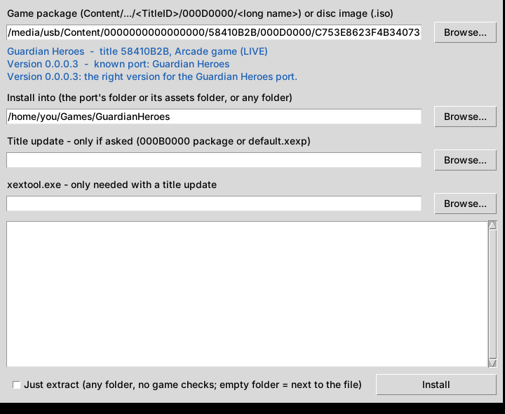

# XBLA Installer

Gets the game files out of **your own Xbox Live Arcade package**, ready for a recompiled PC port
(such as [Trials HD Recomp](https://github.com/trev82usa/TrialsHD-Recomp) or
[Guardian Heroes Recomp](https://github.com/trev82usa/Guardians-of-Heroes-static-recomp)). No
Python, no command line, no other tools: pick the package, pick the port's folder, press
**Install**.

It also works as a plain extractor for any Xbox 360 package (LIVE / CON / PIRS: Arcade games,
title updates, DLC) and for **disc images**: original Xbox and Xbox 360 ISOs (XGD1, XGD2, XGD3).

**Just want the files?** Tick **Just extract**: it pulls everything out into any folder you pick
(or, with the folder left empty, a folder next to the file named after the game), with no port
checks at all.

**Which version have I got?** Pick a package, an ISO or a `default.xex` and it shows the game, its
title ID and its version straight away, and for known ports whether it's the right version.

> **No game data is included.** This tool only reads packages you already own.

<p align="center"></p>

## Download

From the [latest release](../../releases/latest):

- **Windows:** `XBLA-Installer.exe`. Double-click it. (Windows may say it's from an unknown
  publisher: *More info → Run anyway*.)
- **Linux:** `XBLA-Installer-linux-x64.tar.gz`. Extract it and run `./XBLA-Installer`. The
  Python script is in there too (`python3 xbla_installer.py`, window needs `python3-tk`).

## How to use it

1. **Copy the game package off your Xbox 360.** On the console, *Settings → System → Storage*,
   copy the game to a USB drive. On the PC, open the drive with **Velocity**, **Horizon** or
   **FATXplorer** and copy out the file in `Content/0000000000000000/<TitleID>/000D0000/`. It has a
   long hexadecimal name and no extension.
2. **Open XBLA Installer** and pick that file under *Game package*. The installer shows which game
   and version it is, whether it knows a port for it, and whether your version is the right one.
   A disc image (`.iso`) works here too.
3. Under *Install into*, pick **the port's folder** (where `trialshd.exe`, `guardianheroes.exe`
   etc. are). The files go into its `assets` folder automatically. Any other folder works too.
4. Press **Install.** It extracts everything, checks every block of the package, and for known
   ports checks that `default.xex` is the exact version the port was built from.

### "Your copy is version …, the port needs …"

Ports are recompiled from one exact build of a game. If your copy is older, you need its **title
update**: the package from `Content/0000000000000000/<TitleID>/000B0000/`, or a `default.xexp`.
Pick it under *Title update*, along with **xextool.exe** (xorloser's XexTool, not included; put it
next to the installer and it's found automatically), and press **Install** again. The original is
kept as `default.xex.orig`.

## Known ports

| Game | Title ID | Needs default.xex version | Files |
|---|---|---|---|
| Trials HD | `5841095A` | 0.0.1.2 | `default.xex`, `data/` |
| Guardian Heroes | `58410B2B` | 0.0.0.3 | `default.xex`, `media/` |
| Root Beer Tapper | `5841082D` | 0.0.1.2 | `default.xex`, `media/`, `classic/` |
| The Simpsons Arcade | `584108FA` | (not checked) | `default.xex`, `0B/` |

**Adding a port:** put a `games.json` next to the installer with an entry like the ones in this
repository's [`games.json`](games.json). It adds to (or overrides) the built-in list, so port
authors can ship one with their release without rebuilding the installer. Pull requests welcome.

## What it can't open

- **Games on Demand** downloads (a `.data` folder next to the package): a different container, not
  supported yet; use Velocity.
- **Redump-style ISOs that are only the video partition**, or images of other consoles.

## Command line

```
xbla_installer.py --package <package file> --dest <folder> [--update <TU or .xexp>] [--xextool <exe>]
xbla_installer.py --extract-only --package <file> [--dest <folder>]   # just extract, any game
xbla_installer.py --info <package, .iso or default.xex>   # which game / which version
```

## Building

GitHub Actions builds the Windows exe and the Linux binary on every push. Raising `VERSION` in
`xbla_installer.py` publishes release `v<VERSION>` with both attached (notes from
`RELEASE_NOTES.md`). Locally:
`pip install pyinstaller` then
`pyinstaller --onefile --windowed --name XBLA-Installer --add-data "games.json:." xbla_installer.py`
(use `;` instead of `:` on Windows).

## Licence

MIT (`LICENSE`). Not affiliated with Microsoft or any game publisher. xextool is xorloser's and is
not distributed here.
